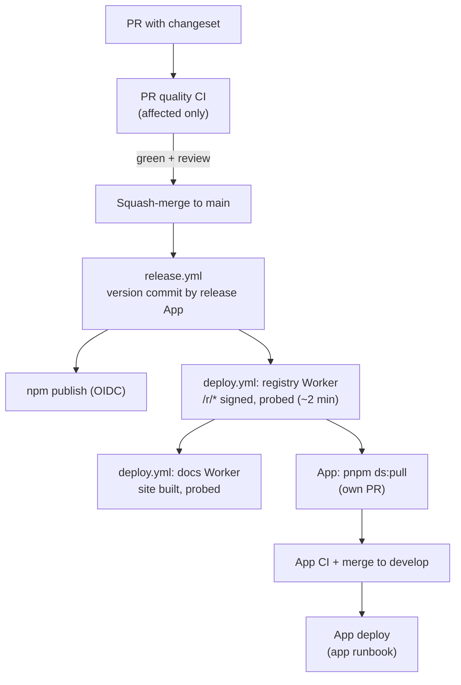

# Runbook — vegastack-design

This is the one procedure for everyone working on this repo: humans, Codex and Claude Code. It is also published,
generated from this file, as the internal docs page `design.vegastack.com/internal/runbook`; edit this file,
never the page. Rules live in [`AGENTS.md`](https://github.com/vegastack/vegastack-design/blob/main/AGENTS.md)
and the reasons behind them in [`docs/decisions.md`](https://github.com/vegastack/vegastack-design/blob/main/docs/decisions.md).
If a workflow or script disagrees with this file, the script is right: fix this file in the same PR.

## The flow



| Step              | Who                        | Command or trigger                                                         | Typical time   |
| ----------------- | -------------------------- | -------------------------------------------------------------------------- | -------------- |
| Change            | you                        | edit, then `pnpm gen` (the pre-commit hook runs it), then `pnpm changeset` | —              |
| PR CI             | automatic                  | `PR quality`, i.e. `pnpm verify:affected`                                  | 3–10 min       |
| Review            | Codex (Claude as fallback) | see § 4a                                                                   | —              |
| Merge             | you                        | `gh pr merge <n> --squash --match-head-commit <sha>`                       | —              |
| Version + publish | automatic                  | `release.yml` on the push to `main`                                        | 2–5 min        |
| Registry deploy   | automatic                  | `deploy.yml` job `registry`, called by `release.yml`                       | ~2 min         |
| Docs deploy       | automatic                  | `deploy.yml` job `docs`, after the registry                                | ~6–8 min       |
| Pull into an app  | you, in the app            | `pnpm ds:pull` → its own PR                                                | 1 min + app CI |

## 1. Who may do what

- A reviewed PR with green CI merges into `main` without asking (operator, 8 October 2026). **The merge is
  the release.**
- Stop and ask MK before you touch any of these: secrets, Cloudflare Access or auth policy, workflow
  permissions, runner trust, destructive data, version reversal, a new sanctioned dependency, a new
  decision-register row, or a shadcn CLI bump.
- Never `git stash`. Work in a worktree: `git worktree add ../.worktrees/<name> -b <branch> origin/main`.

## 2. Setup

```bash
pnpm install          # Node 24.20.0 is pinned by devEngines; pnpm 11 via corepack
pnpm dev              # docs site with every component preview
```

Registry credentials (`CF_ACCESS_CLIENT_ID`/`_SECRET`) are needed only to consume the live registry.

## 3. Change a component

1. Load the `component` skill. Its first question is whether upstream shadcn ships the component.
2. Edit the canonical source `packages/ui/registry/ui/<name>.tsx`. For an upstream component the change is
   a patch hunk that names an **ours** decision ID; author it with `pnpm upstream:diff <name>`.
3. Update the component's test and its MDX page (`apps/docs/content/docs/components/<name>.mdx`).
4. Run `pnpm gen` (~5 s). It runs every generator and also writes the contract fields the source determines
   (exports, dependencies, data attributes, wave rosters). The pre-commit hook runs it when you stage an
   authority.
5. Run `pnpm changeset`. Bump **`@vegastack/ui`** for anything that should release (it is the registry
   version, and a release without it is refused), plus every public package whose source changed
   (`@vegastack/design`, `@vegastack/design-tokens`; their shipped `skills/` count). Open the body with
   one section marker (`🧩 🔧 🗑 🛠 📦 📚 🐛 ⚠️`) and wrap any `<word>` in backticks. Work that should not
   release (tooling, CI, repo docs) takes an empty changeset (`---` / `---` and a one-line body). It
   waits and ships its note with the next real release.
6. Optional local check: `pnpm check:component <name>` or `pnpm check:affected`. CI is the authority.
7. Open the PR. Commit subjects use a conventional prefix (`feat(ui):`, `fix(ui):`, `chore(ci):`, `docs:`)
   and stay under 100 characters.

For UI changes, look at the affected previews in light and dark, at 320px and wide, with their states.
Never commit screenshots.

## 4. What CI runs

`PR quality` (`ci.yml`) is one job on the Linux `vsk-runner` pool, in the pinned Playwright container. It runs
`pnpm verify:affected`, which prints each stage with its time:

| Stage                 | Proves                                                                                                    |
| --------------------- | --------------------------------------------------------------------------------------------------------- |
| typecheck             | every workspace typechecks                                                                                |
| lint                  | formatting, skills, changesets, upstream parity (`upstream:check`), tooling tests, package and docs lints |
| design invariants     | `gen --check` (no stale generated file), contracts, tokens, RSC safety, registry integrity                |
| affected Chromium     | tests for the changed items, their reverse dependents and their geometry fixtures                         |
| real registry consume | the real `shadcn add` round-trip, only when the registry shape, CLI or public packages change             |

After that it runs the workflow lint (`tooling/verify-workflows.mjs`: actionlint, zizmor and house rules,
fully only when `.github/**` changes), the changeset requirement, and a clean-tree check. The whole
component suite runs only on demand (§ 8).

## 4a. Review

Every PR gets one independent review. Codex is the default:

```bash
codex exec -s read-only "Review this branch against origin/main for correctness and security; report high/medium/low with file:line and a fix" < /dev/null
```

Close stdin (`< /dev/null`) or the command waits forever. If Codex is unavailable, run the `review` skill in
a Claude subagent and say so in the PR. Verify every finding against the source, then put the findings and
their resolutions in the PR description.

## 5. Release (automatic)

On every push to `main`, `release.yml` runs three jobs:

1. **version** (environment [`release`](https://github.com/vegastack/vegastack-design/settings/environments),
   main only): if a pending changeset bumps a package, it runs `pnpm run version-packages`, checks the result
   with `tooling/verify-release-commit.mjs` (release outputs only), and commits
   `chore(release): registry x.y.z [skip ci]`. It pushes that commit to `main` as the
   [`vegastack-design-release`](https://github.com/organizations/vegastack/settings/apps/vegastack-design-release)
   GitHub App, the [`main` ruleset](https://github.com/vegastack/vegastack-design/settings/rules/23470280)'s
   only bypass actor; the token is minted per run with `contents: write` only. If `main` moved meanwhile,
   the push is rejected and the newer run releases. An empty changeset (`---\n---`) bumps nothing and
   waits for the next real release.
2. **publish** (OIDC, no token): publishes whatever npm versions are missing:
   [`@vegastack/design`](https://www.npmjs.com/package/@vegastack/design) and
   [`@vegastack/design-tokens`](https://www.npmjs.com/package/@vegastack/design-tokens).
3. **deploy** calls `deploy.yml` for the release commit whenever something was versioned or published.
   It has two jobs:
   - **registry**: `registry:build`, sign the integrity manifest with cosign, deploy the
     `vegastack-design-registry` Worker (`apps/docs/wrangler.registry.jsonc`, route
     `design.vegastack.com/r/*`), then probe `/r/*`. Anonymous requests must be rejected, the service
     token accepted, and the signature valid. Apps can pull as soon as this job is green.
   - **docs**: build the static site once (Turbopack and twoslash caches persist on the runner), deploy
     the `vegastack-design-docs` Worker (custom domain `design.vegastack.com`, everything except `/r/*`),
     then probe the whole boundary. Every non-registry route must be public, and `/internal/*` must be
     unlisted and `noindex`.

   Cloudflare Access protects the **path** `/r/*`, so the auth boundary is the same whichever Worker
   answers; the zone route takes precedence over the docs Worker's custom domain.

A merge without a bumping changeset releases nothing. There are no git tags and no GitHub releases.

Watch it in [Actions](https://github.com/vegastack/vegastack-design/actions): the
[Release](https://github.com/vegastack/vegastack-design/actions/workflows/release.yml) run, then its deploy
jobs. Done means both deploy probes are green: they check the live registry items against
`packages/ui/registry.json` at the release commit. In addition, `npm view @vegastack/design version` and
`npm view @vegastack/design-tokens version` must equal those packages' versions at that commit. A
registry-only release leaves both unchanged.

## 6. Use an unreleased change in an app

Same machine, nothing committed:

```bash
# design-system worktree
pnpm registry:build && pnpm -F @vegastack/docs registry:serve        # serves public/r on :4000
# app
pnpm exec shadcn add http://localhost:4000/<name>.json --overwrite
```

The app's drift check flags this until the real release is pulled.

## 7. Pull a release into an app

In the Regent web app, once the deploy's `registry` job is green:

```bash
pnpm ds:pull --dry-run    # what would change
pnpm ds:pull              # bump packages, overwrite non-current components, refresh skills, strict drift check
```

Commit the result as its own PR, `chore(ds): pull design system <version>`, then follow the app's
[deploy runbook](https://github.com/vegastack/engg-clients-regent-ai-platform-web-app-v2/blob/develop/docs/deploy-runbook.md).
Other apps use `pnpm exec vegastack-design check-updates` and `pnpm exec shadcn add @vegastack/<name> --overwrite`.

## 8. When something fails

| Symptom                                                            | Next action                                                                                                                                                                     |
| ------------------------------------------------------------------ | ------------------------------------------------------------------------------------------------------------------------------------------------------------------------------- |
| CI says "stale", "out of sync" or "run pnpm gen"                   | `pnpm gen`, commit, push                                                                                                                                                        |
| CI: "Some packages have been changed but no changesets were found" | `pnpm changeset` (or an empty one for tooling-only work)                                                                                                                        |
| A browser test fails in CI but passes locally                      | Rerun once. If it passes, note the flake in the PR; if not, fix it                                                                                                              |
| `verify-workflows` fails                                           | Read the house rule it names; never widen the allowlist without MK                                                                                                              |
| Release: push rejected                                             | Nothing to do; the newer `main` run releases                                                                                                                                    |
| Release: publish failed (npm, network)                             | `gh workflow run release.yml` resumes at the `main` tip; it publishes only missing versions, then redeploys                                                                     |
| Deploy failed                                                      | `gh workflow run deploy.yml -f expected_sha=<release sha>`, where the release sha is the `chore(release)` commit (`git log -1 --grep "chore(release)" --format=%H origin/main`) |
| Probe: `/r/*` answers anonymously                                  | Stop. Restore the Access policy first ([Registry operations](https://design.vegastack.com/internal/registry-operations))                                                        |
| Real defect after publish                                          | Patch forward with a fix PR. Never unpublish or overwrite a version. After three failed fixes, stop and report                                                                  |
| Full regression wanted                                             | `gh workflow run full-suite.yml -f commit_sha=<sha> -f engines=chromium` (or `all`)                                                                                             |

## 9. Runners and caches

Every job runs on `[self-hosted, linux, vsk-runner]` (node-01/06/08, shared with the Regent app) inside
`mcr.microsoft.com/playwright:v<lockfile version>-noble`. There are two kinds of cache volume:

- `/opt/vsk-runner/pnpm-store`: used by pull-request jobs.
- `/opt/vsk-runner/pnpm-store-trusted`, `/opt/vsk-runner/trusted-tools` and `/opt/vsk-runner/docs-cache-trusted`:
  mounted only by `release.yml` and `deploy.yml`, so pull-request code never writes into what a credentialed job installs. Tool binaries
  are pinned and SHA-256-checked on every use (`tooling/trusted-tool.mjs`).

To add capacity, follow `docs/runbooks/ci-runner-provisioning-linux.md`.

**Runner network (30-10-2026).** The hosts share a ~22 Mbit/s uplink, and a cold install used to die
there with `ECONNRESET` / `EAI_AGAIN`. The findings are in the Regent app repo at
`.vegastack/plans/ds-workflow/30-runner-network.md`. Three things are now in place:

- **LAN npm cache.** Verdaccio 6.11.1 runs on node-06 as the Docker container `npm-cache`, at
  `http://192.168.88.76:4873/`. It uses the host network and pins `registry.npmjs.org` in its `/etc/hosts`.
  Config is in `/opt/npm-cache/conf/config.yaml` and data in `/opt/npm-cache/storage`. It is read-only:
  `publish: $nobody`, no users, no tokens. `@vegastack/*` metadata is refreshed after 30 s.
- **How workflows use it.** Every workflow install goes through `tooling/runner/pnpm-install.sh`. The
  script uses the cache only for that one command and falls back to npmjs when the cache is down or the
  install fails. Publish never sees the cache. No runner-wide registry default is set.
  - Health check: `curl http://192.168.88.76:4873/-/ping`.
  - Restart: `docker restart npm-cache` on node-06.
  - Remove: `docker rm -f npm-cache`. Jobs fall back to npmjs on their own.
  - If npm's IP changes, recreate the container with the new `--add-host registry.npmjs.org:<ip>`.
- **DNS.** On node-01/05/06/07/08, `/etc/resolv.conf.head` lists 1.1.1.1, then 8.8.8.8. dhcpcd appends
  the router as the backup. To undo on a host:
  `sudo cp /etc/resolv.conf.head.bak-20261030 /etc/resolv.conf.head && sudo dhcpcd -n`. On node-05 and
  node-07, which had no head file before, the undo is `sudo rm /etc/resolv.conf.head && sudo dhcpcd -n`.
- **pnpm network settings.** They are workflow-level `pnpm_config_*` variables. pnpm 11 ignores
  `npm_config_*`.

## 10. Links

- Workflows: [ci](https://github.com/vegastack/vegastack-design/actions/workflows/ci.yml) ·
  [release](https://github.com/vegastack/vegastack-design/actions/workflows/release.yml) ·
  [deploy](https://github.com/vegastack/vegastack-design/actions/workflows/deploy.yml) ·
  [full suite](https://github.com/vegastack/vegastack-design/actions/workflows/full-suite.yml)
- Secrets and variables: [repository settings](https://github.com/vegastack/vegastack-design/settings/secrets/actions):
  `RELEASE_APP_ID` and `DOCS_URL` = `https://design.vegastack.com` (variables), `RELEASE_APP_PRIVATE_KEY` (environment `release` only), `CF_API_TOKEN`, `CF_ACCOUNT_ID`,
  `CF_ACCESS_CLIENT_ID`, `CF_ACCESS_CLIENT_SECRET`
- Live: [docs](https://design.vegastack.com) · registry `https://design.vegastack.com/r/<name>.json` (service
  token) · [changelog](https://design.vegastack.com/docs/changelog)
- Consumer side: [Regent dev handbook](https://github.com/vegastack/engg-clients-regent-ai-platform-web-app-v2/blob/develop/.vegastack/dev.md)
  (Design section) · [Regent deploy runbook](https://github.com/vegastack/engg-clients-regent-ai-platform-web-app-v2/blob/develop/docs/deploy-runbook.md)
